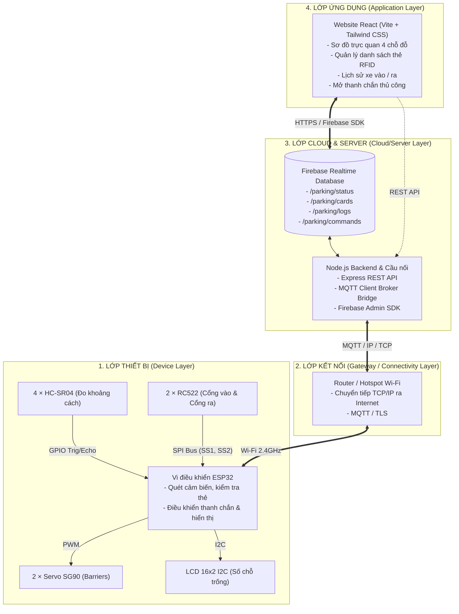

# KIẾN TRÚC HỆ THỐNG BÃI ĐỖ XE THÔNG MINH (4 LỚP)

## 1. Mô hình 4 lớp IoT (IoT 4-Layer Architecture)

---

## 2. Trách nhiệm của từng lớp
1. **Lớp Thiết bị (Device Layer):**
   - Vi điều khiển trung tâm ESP32 quản lý phần cứng cục bộ.
   - 4 cảm biến siêu âm HC-SR04 lấy mẫu định kỳ 2 giây/lần.
   - 2 đầu đọc RFID RC522 kiểm tra thẻ quẹt tại 2 cổng độc lập.
   - 2 động cơ servo SG90 nâng hạ thanh chắn trong 4 giây.
   - Màn hình LCD 16x2 báo số chỗ trống tức thời cho tài xế.

2. **Lớp Kết nối (Gateway Layer):**
   - Điểm truy cập Wi-Fi (Router hoặc Hotspot từ máy tính/điện thoại) cung cấp kết nối mạng TCP/IP cho ESP32.
   - Chuyển tiếp gói tin MQTT qua Internet.

3. **Lớp Cloud & Server (Cloud Layer):**
   - **MQTT Broker:** Tiếp nhận các gói tin publish từ ESP32 và định tuyến lệnh subscribe.
   - **Node.js Backend:** Chương trình cầu nối (Bridge Service) nhận dữ liệu từ MQTT, kiểm tra tính hợp lệ và ghi vào Firebase Realtime Database. Đồng thời cung cấp REST API cho quản trị.
   - **Firebase Realtime Database:** Lưu trữ thời gian thực trạng thái bãi xe, thẻ xe, nhật ký, phân quyền qua Firebase Security Rules.

4. **Lớp Ứng dụng (Application Layer):**
   - Ứng dụng Web Single Page Application (SPA) phát triển bằng React.
   - Đồng bộ hai chiều với Firebase Realtime Database qua Firebase Web SDK.
   - Giao diện trực quan gồm: Sơ đồ vị trí 4 ô đỗ, điều khiển mở cổng khẩn cấp, quản lý danh sách thẻ, bảng log lịch sử.
